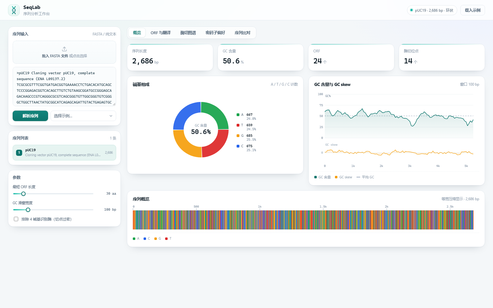
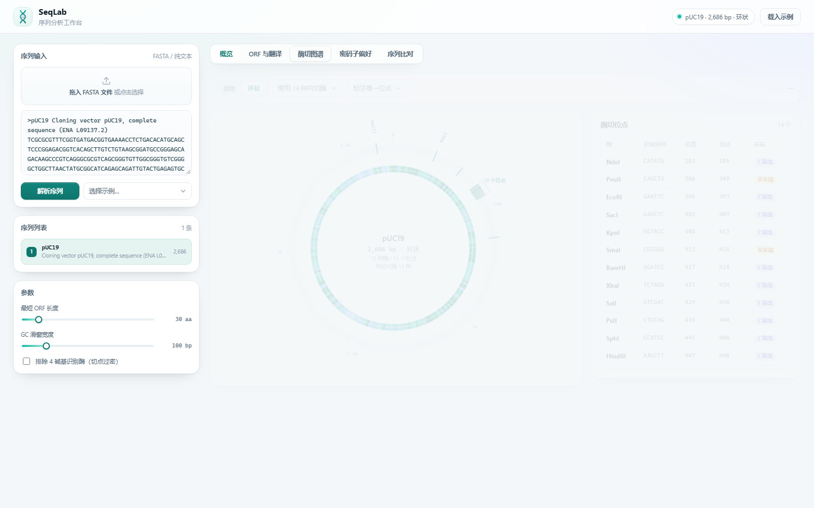

# SeqLab · 序列分析工作台

纯前端 DNA / 蛋白质序列分析工具。**零依赖、无构建、可离线**——双击 `index.html` 就能用。

<p align="center">
  
</p>

## 功能

| 模块 | 内容 |
| --- | --- |
| 序列输入 | FASTA 拖放 / 文件选择 / 粘贴，支持多序列，内置 4 组示例 |
| 概览 | 碱基组成环图、GC 含量与 GC skew 滑窗曲线、全序列彩色概览条 |
| ORF 与翻译 | 六阅读框 ORF 预测（最短长度可调）、ORF 轨道图、密码子-氨基酸对照、序列复制 |
| 酶切图谱 | 39 种限制性内切酶、线性 / 环状质粒图（含 GC 含量环与刻度）、密集位点自动聚合标注、位点表 |
| 密码子偏好 | 64 密码子 RSCU 热图、GC3s、ENC（有效密码子数）、氨基酸组成 |
| 序列比对 | Needleman-Wunsch（全局）/ Smith-Waterman（局部）、可调打分、着色比对、一致度统计、k-mer 点阵图 |

<p align="center">
  
</p>

## 快速开始

```bash
# 方式一：直接打开
双击 index.html

# 方式二：任意静态服务器
python -m http.server 8000
```

快捷键：`1`–`5` 切换标签页。

## 内置示例

| 序列 | 长度 | 来源 |
| --- | --- | --- |
| pUC19 克隆载体 | 2,686 bp（环状） | ENA `L09137.2` |
| φX174 噬菌体基因组 | 5,386 bp | ENA `J02482.1` |
| 人胰岛素 mRNA | 465 bp | Ensembl `ENST00000381330.5` |
| 多克隆位点片段 | 57 bp | pUC 系列 MCS |

均为公开数据库的真实序列，可自行核对。

## 实现要点

- 全部原生 HTML / CSS / JavaScript，**无框架、无构建步骤、无第三方运行时依赖**
- 所有图表由 Canvas 2D 手绘（组成环图、GC 曲线、ORF 轨道、质粒图、点阵图）
- ORF 预测：对每个阅读框预计算 `nextStop` 数组，整体 O(n)
- 比对：完整 DP 矩阵 + 回溯，全局比对补齐边界空位
- 密码子统计：RSCU、GC3s、ENC（Wright 1990 公式）均独立实现

## License

[MIT](LICENSE)
